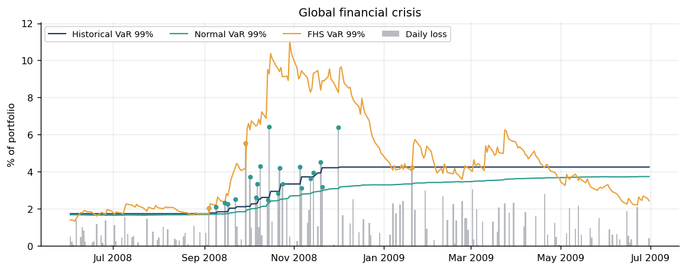
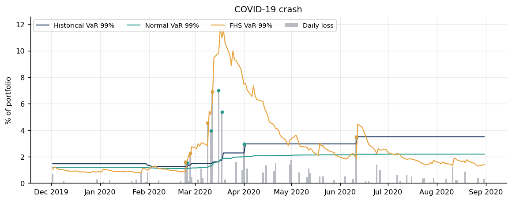
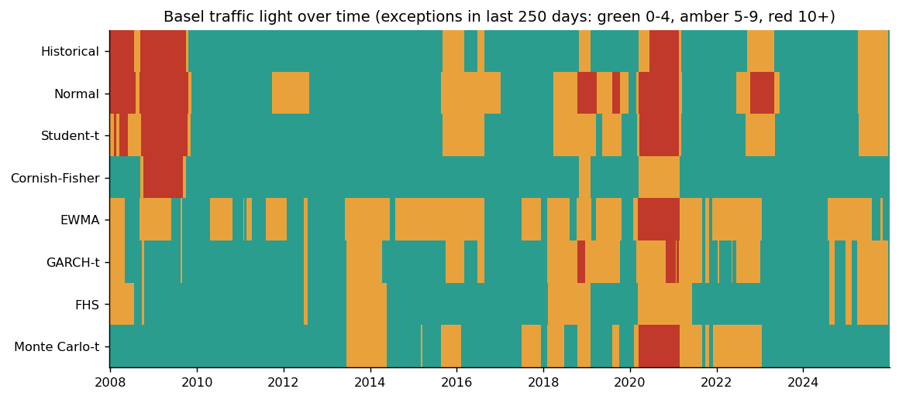
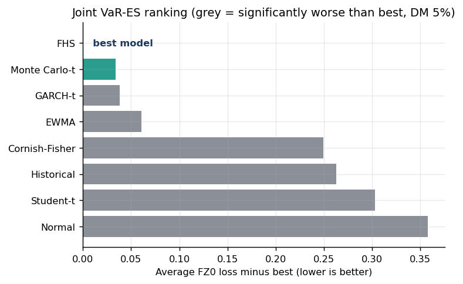

# Market Risk Engine: VaR / ES Models, Back-testing and Model Comparison

[](https://github.com/fazok/market-risk-var/actions/workflows/ci.yml)


**Which VaR model would have survived 2008 and 2020?** This engine estimates
1-day **VaR 99%** and **Expected Shortfall 97.5%** (the FRTB measure) with eight
models. It back-tests them out of sample on 19 years of daily data for a
10-ETF multi-asset portfolio, then ranks them with formal statistical tests.

| Family | Models |
|---|---|
| Unconditional | Historical simulation, Normal, Student-t, Cornish-Fisher |
| Conditional volatility | EWMA (RiskMetrics), GARCH(1,1)-t, Filtered Historical Simulation |
| Simulation | Asset-level Monte Carlo (multivariate t, EWMA covariance) |

**Back-tests:** Kupiec, Christoffersen (independence and conditional coverage),
Basel traffic light, Acerbi-Székely ES test, and the square-root-of-time rule.
**Ranking:** quantile loss for VaR, Fissler-Ziegel **FZ0** loss for the
(VaR, ES) pair, and the **Diebold-Mariano** test.

## Key results (Dec 2006 to Dec 2025, 4,781 out-of-sample days)

| Model | Exceptions (exp. 48) | Kupiec p | Days in red zone | GFC 2008 exc. rate | ES test | FZ0 rank |
|---|---|---|---|---|---|---|
| **FHS** | 67 | 0.009 | **0%** | **2.1%** | green | **1** |
| Monte Carlo-t | 74 | <0.001 | 5.3% | 2.7% | green | 2 |
| GARCH-t | 79 | <0.001 | 2.7% | 2.7% | green | 3 |
| EWMA | 99 | <0.001 | 5.3% | 2.7% | green | 4 |
| Cornish-Fisher | 44 | 0.58 | 5.1% | 7.5% | green | 5 |
| Historical | 75 | <0.001 | 12.8% | 11.0% | green | 6 |
| Student-t | 79 | <0.001 | 12.6% | 13.7% | green | 7 |
| Normal | 108 | <0.001 | 21.4% | 15.8% | yellow | 8 |

1. **Conditional volatility is what matters in a crisis.** Unconditional models
   breach 7–16% of days in late 2008, against 1% expected, because a 500-day
   window reacts months too late. GARCH-type models stay around 2–3%.
2. **Passing Kupiec is not enough.** Cornish-Fisher has the right *average*
   exception rate only because it is the most conservative model on average
   (2.7% VaR vs 1.7–2.1%). Its exceptions are strongly clustered (Christoffersen
   p < 0.001) and it ranks fifth on the consistent loss.
3. **FHS is the best model and the only one never in the red zone**, though no
   model passes conditional coverage over the full period. The Diebold-Mariano
   test cannot separate FHS from Monte Carlo-t (p = 0.15), but it beats all
   other models at 5%.
4. **The √10 rule is borderline.** On non-overlapping 10-day blocks it is not
   rejected at 5% for Historical, Cornish-Fisher, FHS and Monte Carlo, but it is
   rejected for Normal, Student-t, EWMA and GARCH-t.

 
 

Full tables: [reports/backtest_report.md](reports/backtest_report.md).
Methods and references: [docs/methodology.md](docs/methodology.md).

## Quick start

```bash
git clone https://github.com/fazok/market-risk-var.git
cd market-risk-var
make install     # .venv + package with data and dev extras
make test        # 26 tests, no network needed
make all         # downloads prices from Yahoo Finance once (cached), runs the back-test
make demo        # same engine on a simulated GARCH-t portfolio
```

Custom portfolio:

```python
import numpy as np
from marketrisk import data as D
from marketrisk.backtest import run_rolling, summary_table
from marketrisk.models import default_models

R = D.to_returns(D.load_prices(["SPY", "TLT", "GLD"]))
res = run_rolling(R, np.array([0.6, 0.3, 0.1]), default_models(), window=500)
summary_table(res)
```

## Project layout

```
src/marketrisk/
  data.py       Yahoo Finance loader (cached), returns, GARCH-t simulator
  models.py     8 VaR/ES models behind one forecast(R, w, levels) interface
  backtest.py   rolling engine, Kupiec, Christoffersen, traffic light, Z2, 10-day check
  compare.py    quantile and FZ0 losses, Diebold-Mariano (Newey-West)
  plots.py, report.py
scripts/run_backtest.py   end-to-end run -> report, figures, metrics.json
notebooks/                walkthrough calling the package
tests/                    26 tests on known results
```

## What the tests check

* Normal VaR/ES match the closed form. Student-t ES matches numerical integration.
  Cornish-Fisher reduces to the normal quantile without skew or kurtosis.
* GARCH: the variance filter matches the explicit recursion, and MLE recovers the
  true parameters on simulated data.
* ES ≥ VaR for every model.
* Kupiec gives LR = 12.96 for 10 exceptions in 250 days (textbook value).
  Traffic-light boundaries and plus-factors are checked. Christoffersen detects
  clustered exceptions. Z2 ≈ 0 for a correct ES.
* On simulated GARCH data, GARCH-t passes and the i.i.d. normal model fails.
* Quantile and FZ0 losses are minimised at the true VaR/ES, and Diebold-Mariano
  detects a worse model.

## Limitations

Linear, long-only portfolio rebalanced daily. Yahoo adjusted closes are used as
total-return prices. Results depend on the 500-day window and the 20-day GARCH
re-estimation. Non-linear instruments (options) are a planned extension: the
Monte Carlo engine already simulates at asset level for full revaluation.

## Author

**Fatima Zahraa Khihil**, Model Risk Analyst, MSc Big Data & Finance (NEOMA).
[LinkedIn](https://linkedin.com/in/fatimazahraakhihil)

License: MIT
