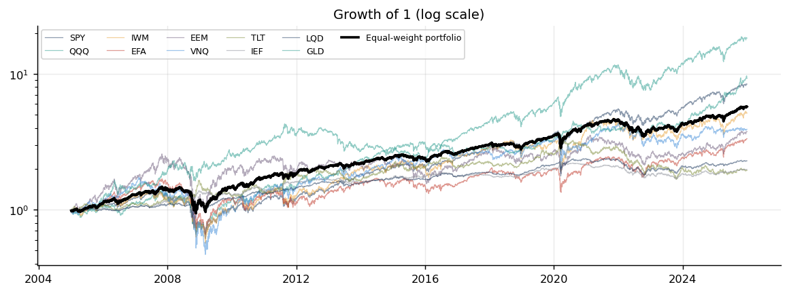
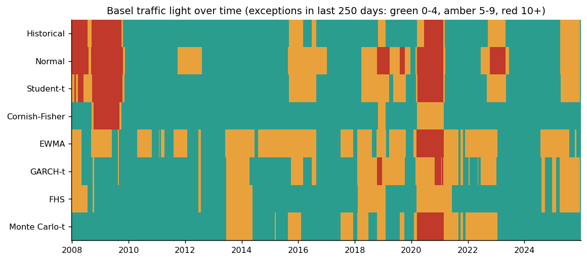
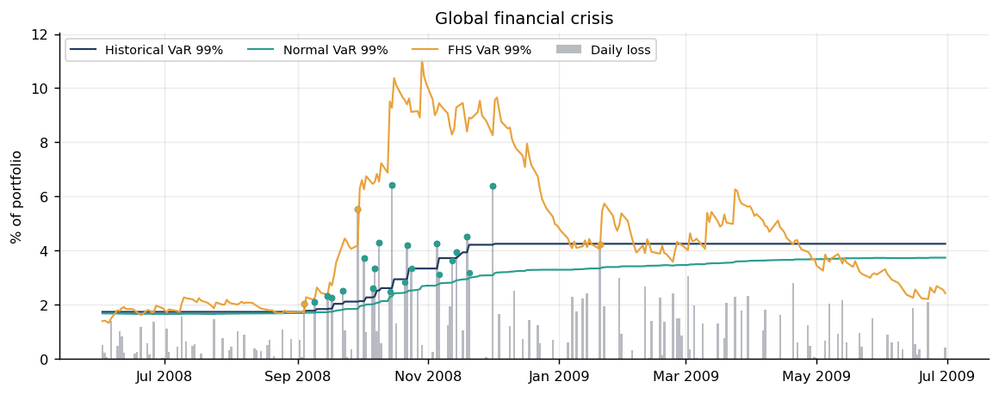
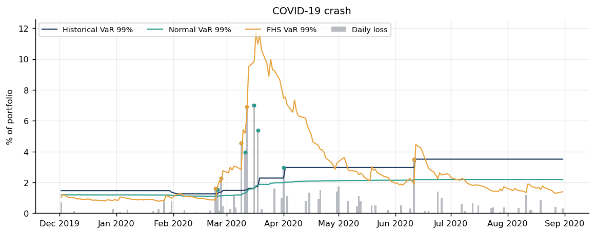
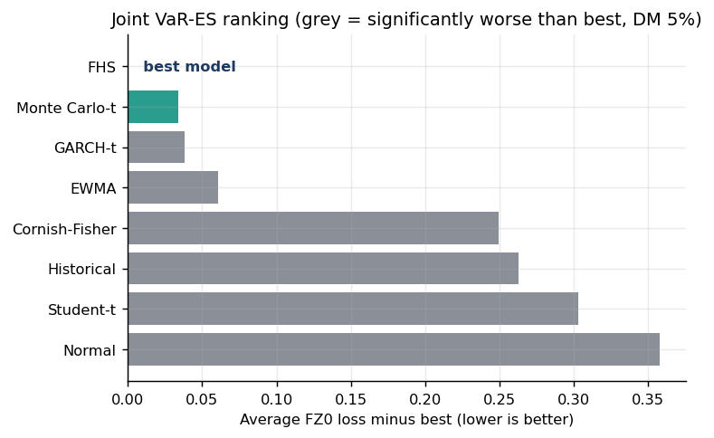
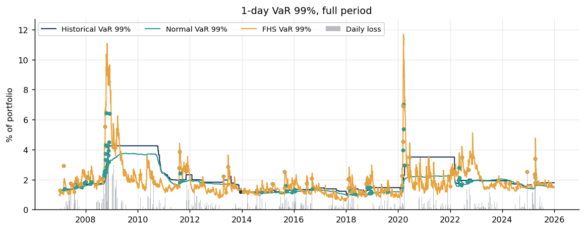

# VaR / ES back-testing report

*Data: **yahoo**, 10 ETFs (SPY, QQQ, IWM, EFA, EEM, VNQ, TLT, IEF, LQD, GLD), equal weight. Out-of-sample period 2006-12-28 to 2025-12-30 (4,781 days), rolling 500-day estimation window, GARCH re-estimated every 20 days.*

Generated by `scripts/run_backtest.py`. Do not edit by hand.

## 1. Regulatory back-tests (1-day VaR 99%, ES 97.5%)

Kupiec tests the exception rate, Christoffersen tests clustering (independence and conditional coverage), the traffic light counts exceptions over 250 days, and Z2 is the Acerbi-Szekely ES test (green < 0.70, red > 1.80).

| model | exceptions | expected | rate_% | kupiec_p | christ_ind_p | christ_cc_p | days_red_% | max_exc_250d | es_z2 | es_zone | avg_var_% |
|---|---|---|---|---|---|---|---|---|---|---|---|
| Historical | 75 | 47.800 | 1.569 | 0.000 | 0.000 | 0.000 | 12.820 | 21 | 0.402 | green | 2.084 |
| Normal | 108 | 47.800 | 2.259 | 0.000 | 0.000 | 0.000 | 21.447 | 27 | 0.848 | yellow | 1.783 |
| Student-t | 79 | 47.800 | 1.652 | 0.000 | 0.000 | 0.000 | 12.555 | 23 | 0.572 | green | 1.970 |
| Cornish-Fisher | 44 | 47.800 | 0.920 | 0.575 | 0.000 | 0.000 | 5.075 | 13 | -0.014 | green | 2.700 |
| EWMA | 99 | 47.800 | 2.071 | 0.000 | 0.005 | 0.000 | 5.318 | 13 | 0.617 | green | 1.661 |
| GARCH-t | 79 | 47.800 | 1.652 | 0.000 | 0.002 | 0.000 | 2.670 | 11 | 0.540 | green | 1.742 |
| FHS | 67 | 47.800 | 1.401 | 0.009 | 0.003 | 0.000 | 0.000 | 8 | 0.160 | green | 1.852 |
| Monte Carlo-t | 74 | 47.800 | 1.548 | 0.000 | 0.000 | 0.000 | 5.274 | 12 | 0.386 | green | 1.825 |

## 2. Behaviour in stress periods (exception rate %, expected 1%)

| model | GFC 2008 (146d) | Euro crisis 2011 (127d) | COVID 2020 (72d) | Rates 2022 (251d) | full (4781d) |
|---|---|---|---|---|---|
| Historical | 10.96 | 3.15 | 12.50 | 1.99 | 1.57 |
| Normal | 15.75 | 4.72 | 12.50 | 3.98 | 2.26 |
| Student-t | 13.70 | 3.15 | 12.50 | 2.39 | 1.65 |
| Cornish-Fisher | 7.53 | 3.15 | 9.72 | 1.20 | 0.92 |
| EWMA | 2.74 | 2.36 | 9.72 | 2.39 | 2.07 |
| GARCH-t | 2.74 | 3.15 | 6.94 | 1.99 | 1.65 |
| FHS | 2.05 | 3.15 | 5.56 | 1.20 | 1.40 |
| Monte Carlo-t | 2.74 | 2.36 | 9.72 | 2.39 | 1.55 |

## 3. Model ranking (consistent scoring functions)

FZ0 is the Fissler-Ziegel loss for the pair (VaR, ES) at 97.5%; the quantile loss scores VaR 99%. The Diebold-Mariano test (Newey-West variance) compares each model with the best one.

| model | rank | quantile_loss_x1e4 | fz0_loss | dm_vs_best | dm_p_value |
|---|---|---|---|---|---|
| FHS | 1 | 2.5444 | -3.9750 |  |  |
| Monte Carlo-t | 2 | 2.6154 | -3.9414 | 1.4558 | 0.1454 |
| GARCH-t | 3 | 2.5715 | -3.9367 | 2.6090 | 0.0091 |
| EWMA | 4 | 2.6877 | -3.9143 | 2.2980 | 0.0216 |
| Cornish-Fisher | 5 | 3.4871 | -3.7257 | 5.2693 | 0.0000 |
| Historical | 6 | 3.4989 | -3.7122 | 3.1442 | 0.0017 |
| Student-t | 7 | 3.5091 | -3.6721 | 3.1311 | 0.0017 |
| Normal | 8 | 3.6347 | -3.6177 | 3.0876 | 0.0020 |

Pairwise DM statistics on FZ0 loss (negative = row model better than column):

| index | Historical | Normal | Student-t | Cornish-Fisher | EWMA | GARCH-t | FHS | Monte Carlo-t |
|---|---|---|---|---|---|---|---|---|
| Historical |  | -2.7 | -2.5 | 0.3 | 2.6 | 2.7 | 3.1 | 3.0 |
| Normal | 2.7 |  | 2.7 | 1.3 | 2.8 | 2.8 | 3.1 | 3.0 |
| Student-t | 2.5 | -2.7 |  | 0.9 | 2.7 | 2.8 | 3.1 | 3.0 |
| Cornish-Fisher | -0.3 | -1.3 | -0.9 |  | 4.2 | 4.4 | 5.3 | 4.9 |
| EWMA | -2.6 | -2.8 | -2.7 | -4.2 |  | 0.9 | 2.3 | 3.4 |
| GARCH-t | -2.7 | -2.8 | -2.8 | -4.4 | -0.9 |  | 2.6 | 0.2 |
| FHS | -3.1 | -3.1 | -3.1 | -5.3 | -2.3 | -2.6 |  | -1.5 |
| Monte Carlo-t | -3.0 | -3.0 | -3.0 | -4.9 | -3.4 | -0.2 | 1.5 |  |

## 4. Square-root-of-time rule (10-day VaR 99% = sqrt(10) x 1-day)

| model | blocks | exceptions | rate_% | kupiec_p |
|---|---|---|---|---|
| Historical | 478 | 9 | 1.883 | 0.084 |
| Normal | 478 | 14 | 2.929 | 0.001 |
| Student-t | 478 | 10 | 2.092 | 0.036 |
| Cornish-Fisher | 478 | 7 | 1.464 | 0.340 |
| EWMA | 478 | 12 | 2.510 | 0.005 |
| GARCH-t | 478 | 10 | 2.092 | 0.036 |
| FHS | 478 | 9 | 1.883 | 0.084 |
| Monte Carlo-t | 478 | 9 | 1.883 | 0.084 |

