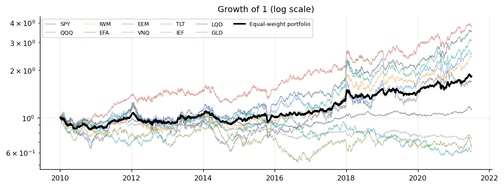
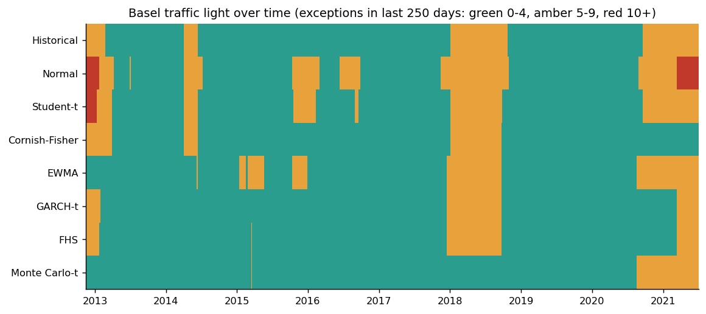
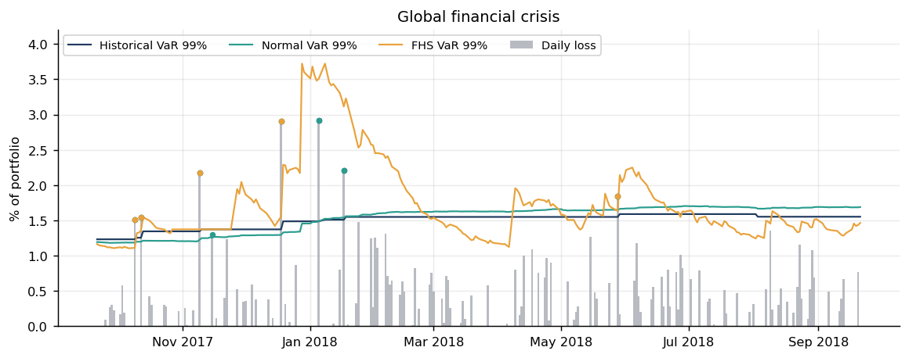
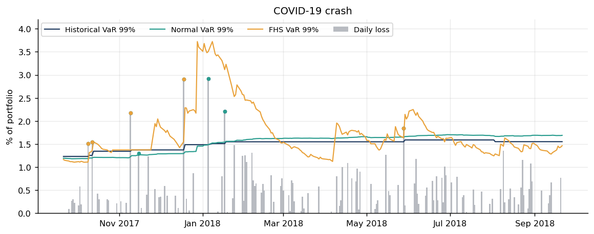
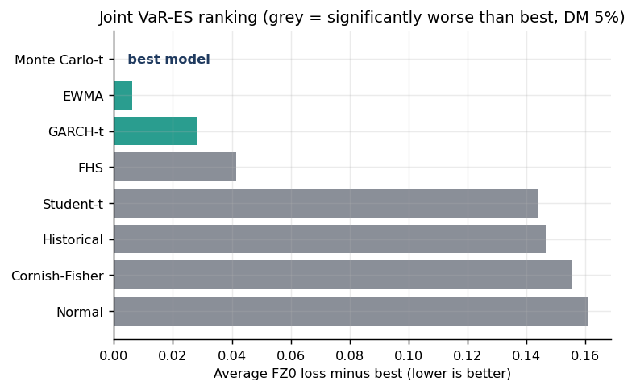
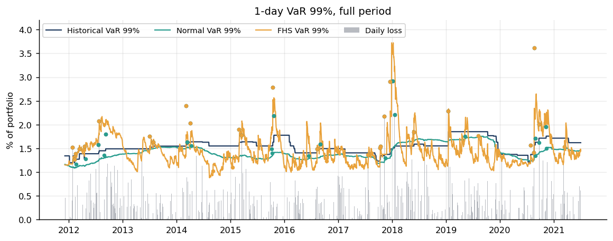

# VaR / ES back-testing report

*Data: **synthetic**, 10 simulated assets, equal weight. Out-of-sample period 2011-12-05 to 2021-07-02 (2,500 days), rolling 500-day estimation window, GARCH re-estimated every 20 days.*

Generated by `scripts/run_backtest.py`. Do not edit by hand.

## 1. Regulatory back-tests (1-day VaR 99%, ES 97.5%)

Kupiec tests the exception rate, Christoffersen tests clustering (independence and conditional coverage), the traffic light counts exceptions over 250 days, and Z2 is the Acerbi-Szekely ES test (green < 0.70, red > 1.80).

| model | exceptions | expected | rate_% | kupiec_p | christ_ind_p | christ_cc_p | days_red_% | max_exc_250d | es_z2 | es_zone | avg_var_% |
|---|---|---|---|---|---|---|---|---|---|---|---|
| Historical | 33 | 25.000 | 1.320 | 0.125 | 0.347 | 0.199 | 0.000 | 8 | 0.301 | green | 1.545 |
| Normal | 48 | 25.000 | 1.920 | 0.000 | 0.935 | 0.000 | 5.775 | 11 | 0.515 | green | 1.420 |
| Student-t | 36 | 25.000 | 1.440 | 0.038 | 0.305 | 0.069 | 1.777 | 10 | 0.320 | green | 1.547 |
| Cornish-Fisher | 26 | 25.000 | 1.040 | 0.842 | 0.460 | 0.746 | 0.000 | 9 | 0.134 | green | 1.756 |
| EWMA | 33 | 25.000 | 1.320 | 0.125 | 0.347 | 0.199 | 0.000 | 6 | 0.172 | green | 1.432 |
| GARCH-t | 29 | 25.000 | 1.160 | 0.433 | 0.409 | 0.523 | 0.000 | 8 | 0.071 | green | 1.525 |
| FHS | 30 | 25.000 | 1.200 | 0.330 | 0.393 | 0.432 | 0.000 | 6 | 0.185 | green | 1.454 |
| Monte Carlo-t | 26 | 25.000 | 1.040 | 0.842 | 0.460 | 0.746 | 0.000 | 6 | 0.024 | green | 1.551 |

## 2. Behaviour in stress periods (exception rate %, expected 1%)

| model | Euro crisis 2011 (20d) | COVID 2020 (75d) | full (2500d) |
|---|---|---|---|
| Historical | 0.00 | 0.00 | 1.32 |
| Normal | 0.00 | 0.00 | 1.92 |
| Student-t | 0.00 | 0.00 | 1.44 |
| Cornish-Fisher | 0.00 | 0.00 | 1.04 |
| EWMA | 0.00 | 2.67 | 1.32 |
| GARCH-t | 0.00 | 0.00 | 1.16 |
| FHS | 0.00 | 0.00 | 1.20 |
| Monte Carlo-t | 0.00 | 2.67 | 1.04 |

## 3. Model ranking (consistent scoring functions)

FZ0 is the Fissler-Ziegel loss for the pair (VaR, ES) at 97.5%; the quantile loss scores VaR 99%. The Diebold-Mariano test (Newey-West variance) compares each model with the best one.

| model | rank | quantile_loss_x1e4 | fz0_loss | dm_vs_best | dm_p_value |
|---|---|---|---|---|---|
| Monte Carlo-t | 1 | 1.9730 | -4.1746 |  |  |
| EWMA | 2 | 1.9691 | -4.1685 | 0.7852 | 0.4323 |
| GARCH-t | 3 | 2.0025 | -4.1466 | 1.6234 | 0.1045 |
| FHS | 4 | 1.9919 | -4.1332 | 2.0657 | 0.0389 |
| Student-t | 5 | 2.2317 | -4.0309 | 3.6886 | 0.0002 |
| Historical | 6 | 2.2034 | -4.0281 | 3.7175 | 0.0002 |
| Cornish-Fisher | 7 | 2.2886 | -4.0192 | 4.5860 | 0.0000 |
| Normal | 8 | 2.2736 | -4.0140 | 3.5713 | 0.0004 |

Pairwise DM statistics on FZ0 loss (negative = row model better than column):

| index | Historical | Normal | Student-t | Cornish-Fisher | EWMA | GARCH-t | FHS | Monte Carlo-t |
|---|---|---|---|---|---|---|---|---|
| Historical |  | -1.2 | 0.3 | -0.6 | 3.5 | 3.8 | 3.4 | 3.7 |
| Normal | 1.2 |  | 1.9 | 0.2 | 3.4 | 3.7 | 3.2 | 3.6 |
| Student-t | -0.3 | -1.9 |  | -0.9 | 3.4 | 3.9 | 3.1 | 3.7 |
| Cornish-Fisher | 0.6 | -0.2 | 0.9 |  | 4.1 | 5.3 | 4.2 | 4.6 |
| EWMA | -3.5 | -3.4 | -3.4 | -4.1 |  | -1.1 | -1.8 | 0.8 |
| GARCH-t | -3.8 | -3.7 | -3.9 | -5.3 | 1.1 |  | -1.1 | 1.6 |
| FHS | -3.4 | -3.2 | -3.1 | -4.2 | 1.8 | 1.1 |  | 2.1 |
| Monte Carlo-t | -3.7 | -3.6 | -3.7 | -4.6 | -0.8 | -1.6 | -2.1 |  |

## 4. Square-root-of-time rule (10-day VaR 99% = sqrt(10) x 1-day)

| model | blocks | exceptions | rate_% | kupiec_p |
|---|---|---|---|---|
| Historical | 250 | 4 | 1.600 | 0.380 |
| Normal | 250 | 5 | 2.000 | 0.162 |
| Student-t | 250 | 5 | 2.000 | 0.162 |
| Cornish-Fisher | 250 | 2 | 0.800 | 0.742 |
| EWMA | 250 | 3 | 1.200 | 0.758 |
| GARCH-t | 250 | 3 | 1.200 | 0.758 |
| FHS | 250 | 3 | 1.200 | 0.758 |
| Monte Carlo-t | 250 | 3 | 1.200 | 0.758 |

